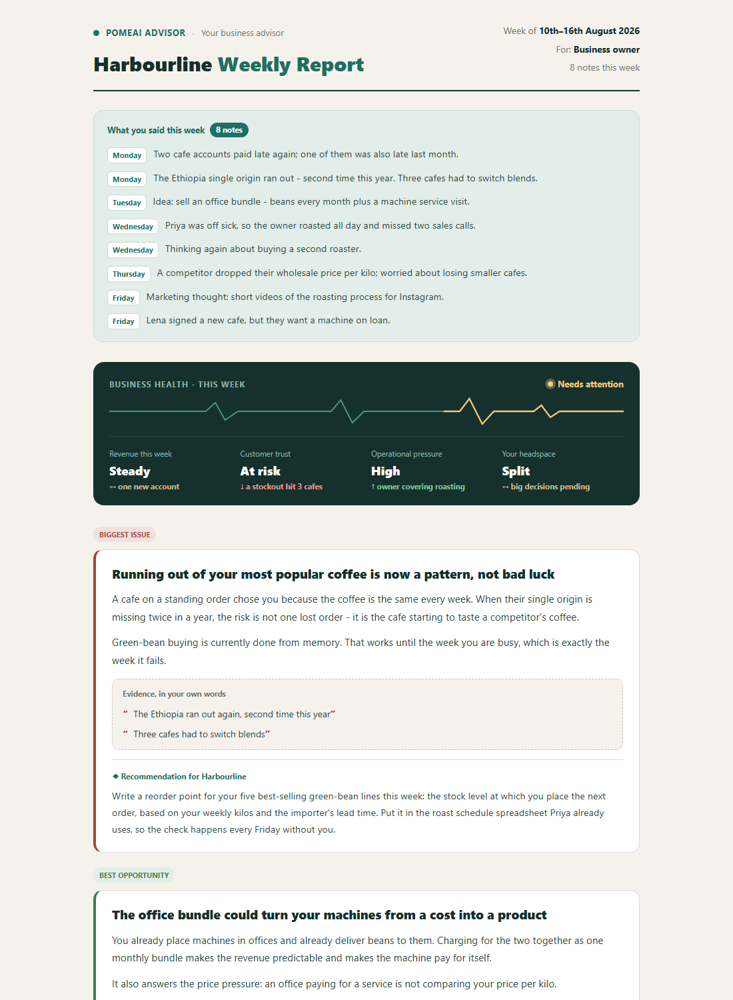

# Business Advisor — an AI advisor that listens to your week

*by POMEAI*

**The owner talks; the advisor thinks.** Through the week a business owner sends short voice
notes on Telegram: whatever is on their mind, in their own words. Every Monday they get one
clear report: the biggest issue, the best opportunity, what they may be avoiding, and **just
three priorities** for the week ahead.

**▶ [See a sample weekly report](https://marzieh-manager.github.io/business-advisor/examples/sample-weekly-report.html)**

[](https://marzieh-manager.github.io/business-advisor/examples/sample-weekly-report.html)

> I built this for the owner of a real distribution business. To protect the client, this
> public version runs on **Harbourline Coffee Co.**, a fictional Sydney coffee roaster. Every
> name, number and note in the examples is invented.

---

## The problem it solves

Business owners have their best thinking in scattered moments: in the car, between calls,
after a bad day. Those thoughts are rarely written down, so the same problems come back week
after week and nobody connects them.

POMEAI Advisor captures those moments with almost no effort (hold the mic button and talk) and
turns a week of them into decisions.

## What the weekly report contains

| # | Section | What it does |
|---|---|---|
| 1 | What you told me this week | Every note, summarised, by day |
| 2 | Business health | Four vital signs with a trend |
| 3 | Biggest issue | Backed by **quotes from the owner's own notes** |
| 4 | Best opportunity | With a small, low-cost first step |
| 5 | What you may be avoiding | Connects separate notes into one pattern the owner hasn't spotted |
| 6 | Leadership lesson | Turns a hard moment into a system for next time |
| 7 | For your next marketing meeting | Filters ideas into **now / keep / park** |
| 8 | Next week: just 3 priorities | Always exactly three |
| 9 | Day by day | A simple action plan |
| 10 | Follow-up from last week | Did last week's decisions actually happen? |

## How it works

```
Telegram voice note  ->  transcription (Whisper or Gemini)  ->  SQLite, one row per note
        -> weekly: business context + sector lens + the week's notes  ->  Claude
        -> structured JSON, validated  ->  HTML report  ->  credibility audit
```

## What makes it trustworthy

- **Grounded in one business.** [`business_context/business.md`](business_context/business.md)
  describes the business, its people, goals and vocabulary, and is read into every report.
  Adapting the advisor to a new business means rewriting this one file, not the code.
- **Evidence in the owner's own words.** Every claim is quoted from that week's notes.
- **Invents nothing.** The advisor may not make up a name, number, date or study. A worked-out
  fact must be marked as worked out.
- **Audited before sending.** [`tools/audit_report.py`](tools/audit_report.py) checks every
  quote against the real transcripts and traces every name, date and number back to its source.
- **Private by design.** The bot accepts notes from one person only, and report filenames are
  unguessable.
- **Fails loudly, not silently.** If a note can't be transcribed, an operator is alerted, so
  nothing quietly disappears from Monday's report.

## Try it in two minutes (no API keys needed)

```bash
python -m venv venv
venv/Scripts/pip install -r requirements.txt      # Windows
# source venv/bin/activate && pip install -r requirements.txt   # macOS / Linux

python tools/render_sample.py      # renders examples/sample-weekly-report.html
python -m pomeai.cli check         # checks config, business context and template
```

For the full loop, copy `.env.example` to `.env` and add a Telegram bot token, a transcription
key (OpenAI or Gemini) and an Anthropic key. Then:

```bash
python -m pomeai.cli bot                   # receive voice notes
python -m pomeai.cli report --week last    # generate last week's report
python -m pomeai.cli report --dry-run      # show the exact prompt, spend nothing
python -m pomeai.cli status                # is everything working?
```

## Project layout

| Path | What it is |
|---|---|
| `business_context/business.md` | The business the advisor knows (sample: fictional coffee roaster) |
| `business_context/sector.md` | Industry patterns, used as a lens, never as evidence |
| `pomeai/bot.py` | Telegram intake, locked to the owner's chat |
| `pomeai/transcription/` | Swappable transcription providers (Whisper, Gemini) |
| `pomeai/advisor.py` | The weekly advisor prompt and the Claude call |
| `pomeai/report.py` | Renders the advisor's output into the HTML report |
| `pomeai/watchdog.py`, `alerts.py` | Silence detection and failure alerts |
| `templates/weekly-report.html` | The report design ([slot contract](templates/SLOTS.md)) |
| `tools/audit_report.py` | Credibility audit for every report |
| `examples/` | Sample advisor output and the rendered report |

**Stack:** Python · Telegram Bot API · OpenAI Whisper / Google Gemini · Anthropic Claude ·
SQLite · Jinja2

## Status

Milestones 0–4 are done: capture, transcription, storage and the weekly report. Next come
automatic Monday delivery and a validation period with the real owner.

---

## خلاصه به فارسی

**دستیار مشاور کسب‌وکار POMEAI**: صاحب کسب‌وکار در طول هفته هر وقت فکری به ذهنش رسید یک
ویس کوتاه در تلگرام می‌فرستد. دوشنبه‌ها یک گزارش روشن تحویل می‌گیرد: بزرگ‌ترین مشکل، بهترین
فرصت، چیزی که شاید از آن طفره می‌رود، و فقط **سه اولویت** برای هفته‌ی بعد.

- هر توصیه به **حرف‌های خودِ صاحب کسب‌وکار** استناد می‌کند، نه توصیه‌ی کلی.
- هیچ عدد، اسم یا تاریخی از خودش نمی‌سازد، و هر گزارش پیش از ارسال بررسی می‌شود.
- برای هر کسب‌وکار جدید فقط یک فایل (شناخت‌نامه‌ی کسب‌وکار) عوض می‌شود.

[نمونه‌ی گزارش هفتگی را ببینید](https://marzieh-manager.github.io/business-advisor/examples/sample-weekly-report.html)
